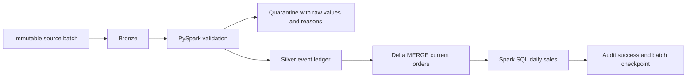

# Agentic DataOps: Phase 1 order pipeline

A code-first PySpark and Delta Lake pipeline for fictional e-commerce orders.
This branch extends the original working Bronze/Silver/Gold demo. AI agents,
LLMs, MCP, ML, human approvals and visual drag-and-drop ETL are later phases.

**Implemented locally:** incremental Delta batches, real CDC MERGE, tombstones,
replay-safe recovery, data quality/quarantine, schema handling, Spark SQL Gold,
and audit/checkpoints. **Fabric execution is blocked and unverified.** See the
[verification report](docs/verification.md) for measured results and CI status.

## Architecture



| Layer | Storage | Purpose |
| --- | --- | --- |
| Source | Three fictional CSV files per batch | Customers, products and insert/update/delete order events |
| Bronze | Delta, partitioned by batch | Original parsed fields and delivery metadata |
| Silver events | Delta | Unique typed events, including late events |
| Silver current | Delta with MERGE | One deterministic current row per order; deleted rows retain tombstones |
| Quarantine | Delta, partitioned by batch | Rejected rows, original JSON and explicit reasons |
| Gold | Delta, transformed with Spark SQL | Active order count and decimal revenue by date/category |
| Audit/checkpoint | Delta | Attempt status, counts, timestamps, duration, fingerprints and committed batch IDs |

The [architecture and contracts](docs/architecture.md) explain ordering,
reconciliation, schema evolution, storage paths and failure behavior.

## Set up in Codex Cloud or Linux

The verified local versions are Python 3.12, Java 21, PySpark 4.0.5 and Delta 4.0.0.
Java 17 or newer is required by Spark 4; CI uses 21. The direct Spark/Delta
versions and development dependencies are pinned. Run from this checkout:

```bash
bash scripts/setup_environment.sh
source .venv/bin/activate
python -m pytest -q --junitxml=build/test-results.xml
```

Setup installs into `.venv`, verifies Maven's published checksums for the two
Delta jars in `.cache/delta`, and uses inherited HTTPS proxy/TLS settings. PySpark
supplies Scala 2.13 and ANTLR. No Java-side Maven access or cloud credentials are
needed to run local Delta. `DATAOPS_DELTA_JARS` can select an alternate jar folder.

## Run the Delta pipeline

```bash
dataops-pipeline --input data/batches/001_initial --output build/lakehouse --format delta --batch-id 001_initial
dataops-pipeline --input data/batches/002_changes --output build/lakehouse --format delta --batch-id 002_changes
python scripts/inspect_lakehouse.py --output build/lakehouse
```

Reuse the same immutable batch ID to safely replay it. A completed batch returns
`already_processed`; new input under an old ID is rejected. The original snapshot
example remains available with `--input data/sample --format parquet`; it rebuilds
the supplied snapshot and does not claim incremental or failure-recovery guarantees.

For the complete reproducible demo, including a deliberate failure and recovery:

```bash
python scripts/demo.py --output build/demo
```

Use a fresh output directory for the demo. See [the step-by-step guide](docs/demo.md)
for inspecting tables and running each step in a separate Spark process.

| Batch | Input | Valid | Rejected | Active orders | Revenue |
| --- | ---: | ---: | ---: | ---: | ---: |
| 001 initial | 10 | 6 | 4 | 3 | 1758.00 |
| 002 changes and late events | 8 | 5 | 3 | 3 | 3117.00 |
| 003 optional schema addition | 1 | 1 | 0 | 4 | 3357.00 |

These are fictional demo amounts, not production performance or quality claims.

## Operational scope

- Run one writer per output root. Recover an unfinished batch before starting
  another. There is no distributed lock or cross-table atomic transaction.
- Source files are immutable, at most 64 MiB each. Reference CSVs remain unchanged
  across batches. A production source manifest and changing dimensions need more work.
- All deletes carry the full order contract. The newest event wins; ties use
  delete/update/insert priority, then a stable content key. Older events never
  overwrite newer state. All valid late events remain in Silver events.
- Additive fields survive; missing or renamed required fields fail clearly.
  Malformed CSV structure fails the batch. Invalid row values are quarantined.
- Gold is recalculated from **current Silver state**. It is not a full-history
  source rebuild. Readers must wait for the success checkpoint and no pending batch.

## Fabric and delivery

[Fabric deployment instructions](docs/fabric.md) include the job entry point,
configuration template, compatible runtime requirement and evidence checklist.
They write Delta paths in OneLake Files; managed table registration and SQL
analytics endpoint discovery are not claimed. No chargeable service is created.

Development continues on `feature/phase1-spark-pipeline` in existing draft
[PR #1](https://github.com/chandrakanth02512-ctrl/agentic-dataops-self-healing-pipeline/pull/1).
Do not merge without review. Credentials and environment secrets must stay out
of GitHub. [Phase 1 verification](docs/verification.md) separates completed local
work from GitHub Actions and Fabric results.
