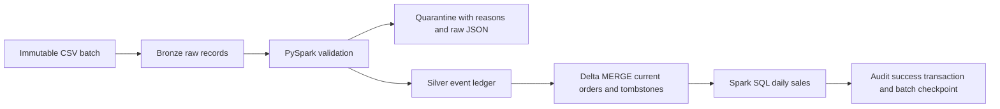

# Phase 1 architecture and contracts

This is a code-first e-commerce pipeline. Every supplied customer and order is
fictional. AI, LLMs, MCP, ML, approvals and visual ETL belong to later phases.

## Storage

Paths are relative to `--output`. Delta is the incremental execution path.
The original Parquet path remains a full-input snapshot demo with append-only
audit reports; it does **not** offer Delta checkpoints or incremental recovery.

| Layer | Path / format | Contract |
| --- | --- | --- |
| Source | One folder per batch; three CSV files | Immutable `orders.csv`, `customers.csv`, `products.csv`; each at most 64 MiB |
| Bronze | `bronze/orders`, `bronze/customers`, `bronze/products`; Delta | All parsed source rows, including duplicates, plus batch ID, source file, load time; partitioned by batch |
| Silver events | `silver/order_events`; Delta | Typed, unique accepted events with event key, batch ID, original JSON and optional fields |
| Silver current | `silver/current_orders`; Delta | One row per order, latest event key/time, operation rank and `is_deleted` |
| Quarantine | `quarantine/orders`; Delta | Rejected typed rows, original JSON, batch ID and explicit first failure reason |
| Gold | `gold/daily_sales`; Delta | Date/category, active order count and decimal revenue |
| Audit/checkpoint | `audit/runs`; Delta | One row per attempt; only `status = 'success'` commits a batch |

The source folder is retained. Bronze preserves parsed CSV values, while the
source files preserve original bytes (including formatting). Optional additions
remain strings in Bronze/Silver/current state. Only declared order contract fields
are cast. A newer full-row event that omits an optional field sets that field to
null in current state. Quarantine retains `raw_record` before casting so malformed values are
not lost. Structurally malformed CSV fails the batch using `FAILFAST`; it is not
silently shortened, ignored or treated as an empty batch.

## Table contracts

| Input | Required fields |
| --- | --- |
| Customers | `customer_id`, `customer_name`, `region`: nonempty strings; unique customer ID |
| Products | `product_id`, `product_name`, `category`: nonempty strings; unique product ID |
| Orders | `order_id`, `customer_id`, `product_id`: nonempty strings and valid foreign keys |
| Order values | `quantity`: positive integer; `unit_price`: positive DECIMAL(12,2), at most two fractional digits; no silent rounding |
| Order state | `order_status`: Placed, Updated, Shipped, Delivered or Cancelled; `operation`: I, U or D |
| Order times | `order_date`: parseable date; `event_time`: parseable timestamp interpreted in UTC |

The scenario models one product line per order ID, not multi-line baskets. All
operations, including deletes, carry a complete row. A delete for an unseen key
creates a tombstone. An update for an unseen key is an upsert. A newer insert or
update can revive a deleted order; an older event cannot. Reference snapshots
must stay byte-identical across batches in one output lakehouse. Slowly changing
dimensions and reference corrections are outside this Phase 1 implementation.

Required headers are exact, lowercase names. Extra columns with simple lowercase
SQL identifiers are allowed, except reserved pipeline metadata names. Missing or
renamed required headers fail clearly; no mapping is inferred. Introduce an
explicit, reviewed source mapping in code before replaying a failed schema batch.
Changing an already registered file requires a new output/reprocessing decision;
reusing an existing batch ID with different bytes is rejected, even after failure.

## Incremental events and ordering

Each invocation reads only its submitted batch. SHA-256 fingerprints of the three
files bind its ID to source bytes; duplicate delivery of a committed batch returns
`already_processed` without rewriting any business table. Fingerprinting still
reads the submitted files. The event ledger is searched by key for deduplication;
it is not replayed to rebuild current state. Full counts are used for reconciliation.

An event key is SHA-256 of canonical JSON of the nine typed order contract fields.
JSON avoids delimiter and null-sentinel collisions. Optional fields do not change
business event identity. Exact duplicates within a batch keep the lexically first
raw JSON payload; later deliveries across batches are quarantined as
`duplicate_event`. The first accepted optional payload wins across deliveries.
Distinct events at the same timestamp are retained in Silver events.

Current state uses the same descending tuple in PySpark and Delta MERGE:

1. `event_time`;
2. operation priority D > U > I;
3. `event_key` as a stable tie-breaker for equally timed, same-operation conflicts.

One source row per order reaches MERGE, avoiding duplicate source matches.
The matched update condition requires a strictly greater tuple. Tombstones stay
in Silver permanently in this phase. All valid late events stay in the event
ledger; only a winning tuple changes current state. `max_event_time` is an observed
high-water mark, not an event rejection cutoff. There is no lateness expiration.
Changing timestamp parsing, the event key algorithm or priority requires a
versioned migration; do not reinterpret an existing lakehouse in place.

## Writes, failures and reconciliation

Use a single writer per output root (orchestrator concurrency **1**). There is no
distributed writer lock. Parallel invocations are unsupported; the pending-batch
check is a recovery guard, not mutual exclusion.

The pipeline registers an attempt, validates schemas and reference keys, writes
Bronze batch partitions, quarantines rejects, merges unique events and current
state, then replaces the Gold snapshot. It reconciles:

- input = valid + rejected;
- persisted Bronze, Silver event and quarantine counts for this batch;
- unique current order IDs;
- Gold order count and revenue against active Silver state.

Only after these writes and checks does one audit Delta transaction set the
attempt to `success`. That same row is the checkpoint: there is no separate
checkpoint write that could get ahead of the audit. No essential write follows
it. A normal failure updates the attempt to `failed`. A killed driver leaves
`running`; both states require replay. If audit storage also fails, driver logs
carry the failure and the prior non-success checkpoint remains authoritative.
Pre-registration failures (missing files, wrong identity, blocked later batch)
are logged but do not create misleading accepted batch registrations.

On retry, Bronze/quarantine replace only the failed batch partition; insert-only
event MERGE and ordered current-state MERGE are idempotent. Own pending events
are not mistaken for duplicates from a different batch. Gold is recalculated
from current Silver state, including corrections to earlier dates. On successful
replay, audit retains the failed attempt plus the successful attempt. Counts
`*_before` describe the start of **that attempt**, so recovery can start with some
writes already applied. Unmeasured counts are null, not zero. Duration ends just
before the final checkpoint write and excludes Spark process startup/teardown.

Delta commits are atomic **per table**, not across all layers. Readers must wait
for the batch success marker and no pending batch before consuming a coherent
snapshot. A partial run may expose changed Silver with old Gold. This is not a
transactional serving layer and does not provide snapshot isolation across tables.
Do not delete checkpoints/tombstones or run VACUUM during recovery. A production
retention, concurrency and publication strategy is separate work.

The readable Gold query is packaged at
`src/agentic_dataops/sql/daily_sales.sql` and executed against PySpark temp views in
the same session. `DECIMAL(16,2)` bounds Gold revenue; an overflow fails a batch
instead of issuing a success checkpoint.
